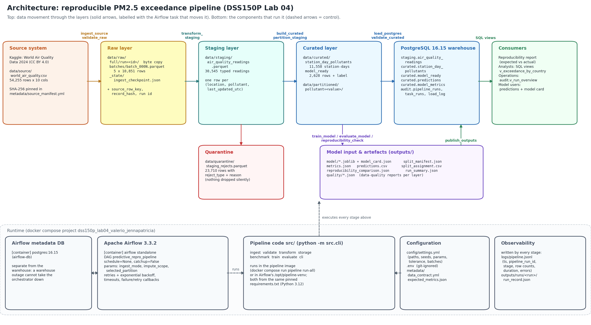

# DSS150P Lab 04 — Reproducible PM2.5 Exceedance Pipeline

This repository rebuilds a Predictive Analytics group project as a **reproducible, rerun-safe data product**:
the same checksummed source dataset is ingested, validated, transformed, stored, orchestrated, tested and
used to regenerate the original model results, with the **same train/test rows** as the original notebook:
- **Windows:** every baseline metric is reproduced exactly (maximum difference 0 at 6 decimal places).
- **Linux Docker/Airflow containers:** all test-set metrics are identical; one Gradient Boosting cross-validation
  fold differs slightly (CV mean 0.711814 vs 0.712210, a difference of 0.0004), which is within the declared
  ±0.0005 tolerance. The cause is explained in the [reproducibility report](docs/reproducibility_report.md).

| Field | Entry |
|---|---|
| Name | Jenna Patricia G. Valerio |
| Student Number | 2024102708 |
| Section | DSS150P_CM17 |
| Previous Predictive Analytics Project | *Predicting PM2.5 Air Quality Exceedances Using Machine Learning: A Co-Pollutant Chemistry Approach* |
| Dataset Name / Source | World Air Quality Data 2024 (Updated), Kaggle user kanchana1990, CC BY 4.0 |
| Predictive Task | **Classification**: station-day PM2.5 > 15 µg/m³ (WHO 24-h guideline) → *Unhealthy*, else *Safe* |

**Key documents:**

| Document | Contents |
|---|---|
| [Reproducibility report](docs/reproducibility_report.md) | Baseline vs reproduction, deviations, reflection answers |
| [Runbook](docs/runbook.md) | Operation, failures, recovery |
| [Benchmark report](docs/benchmark_report.md) | Storage formats and partitions |
| [Lifecycle & engineering gaps](docs/lifecycle_and_gaps.md) | Phase I analysis |
| [Source profile](metadata/source_profile.md) | Profile of the source dataset |
| [Data contract](metadata/data_contract.yml) | Rules and violation behaviour |

---

## 1. Result at a glance

| Model | Accuracy (baseline → reproduced) | Weighted F1 | 5-fold CV F1 (mean) |
|---|---|---|---|
| Logistic Regression | 0.673004 → 0.673004 | 0.656994 → 0.656994 | 0.672786 → 0.672786 |
| Random Forest | 0.716730 → 0.716730 | 0.716283 → 0.716283 | 0.707718 → 0.707718 |
| **Gradient Boosting** (best, primary metric) | 0.705323 → 0.705323 | 0.704445 → 0.704445 | **0.712210 → 0.712210** |

Values above are from the Windows run. In the Linux containers, Gradient Boosting's CV F1 is 0.711814 ± 0.006152
(the baseline is 0.712210 ± 0.006402); everything else is identical (`docs/evidence/platform_difference.txt`).

**Tolerance rule:** every metric must satisfy |reproduced − baseline| ≤ 0.0005 (3 decimal places), and row counts and split
checksums must match exactly. The pipeline checks this automatically: it writes `outputs/reproducibility_comparison.json`
and stops before publishing if the check fails.

## 2. Architecture



Dataset- and field-level lineage (source → raw → staging → curated → model features → model → outputs):
[docs/lineage.png](docs/lineage.png).

| Layer | Location | Semantics | Owner / writer |
|---|---|---|---|
| Source | `data/source/world_air_quality.csv` | Immutable evidence of the original dataset; never modified; SHA-256 in `metadata/source_manifest.yml` | Upstream publisher (read-only) |
| Raw | `data/raw/full/run=<id>/`, `data/raw/batches/`, `data/raw/_state/` | Faithful copy: byte copy per full run plus 5 checkpointed batches; all source fields as text plus `source_row_key`, `record_hash`, `pipeline_run_id`, `ingested_at_utc`, `source_file`, `source_checksum` | `ingest` |
| Staging | `data/staging/air_quality_readings.parquet`, `staging.air_quality_readings` | Typed, standardised, deduplicated readings of the 6 in-scope pollutants in µg/m³ (30,545 rows) | `transform-staging` |
| Quarantine | `data/quarantine/staging_rejects.parquet` | Every rejected row with `reject_type` / `reject_reason` / `check_id` (23,710 rows); raw = staging + quarantine | `transform-staging` |
| Curated | `data/curated/*.parquet`, `curated.station_day_pollutants`, `curated.model_ready` | Station-day means (11,558); model-ready rows with derived features and the WHO label (2,628) | `build-curated`, `load-postgres` |
| Model input | in memory, described by `outputs/split_manifest.json` | Ordered features, SO2/CO median imputation, deterministic stratified split (2,102 / 526) | `train` |
| Outputs | `outputs/`, `curated.predictions`, `curated.model_metrics` | Models + model card, metrics, predictions, reproducibility comparison, run summary | `train`, `evaluate`, `publish` |

## 3. Prerequisites

- **Git**
- **Docker Desktop** (Windows/macOS) or Docker Engine with Compose v2. Give Docker at least 4 GB of RAM. On Windows
  with WSL2 the default is half of your RAM, which is enough on 8 GB+ machines.
- **Optional, only to run without containers:** Python 3.12.

The first `docker compose up --build` downloads about 4 GB of images (Airflow, PostgreSQL, Python) and builds two
images. That takes several minutes; later starts take seconds.

## 4. Quick start from a clean clone

```bash
git clone https://github.com/TrishzMe/DSS150P_Lab04_Valerio_JennaPatricia.git
cd DSS150P_Lab04_Valerio_JennaPatricia
```

**1. Data:** the source CSV is already included (CC BY 4.0), see section 5.

**2. Configuration:** create `.env` from the template and replace the four `change_me...`/`replace...` values with
your own passwords and a long random string:

```bash
cp .env.example .env              # PowerShell: Copy-Item .env.example .env
```

**3. Start PostgreSQL, the Airflow metadata DB and Airflow:**

```bash
docker compose up -d --build
docker compose ps                 # wait until all three services show "healthy"
```

**4. Run the pipeline. Pick one option:**

- **Airflow UI:**
  1. Open http://localhost:8081 and sign in as `admin` with `AIRFLOW_ADMIN_PASSWORD` from `.env`.
  2. Open the DAG `predictive_repro_pipeline` and click **Trigger** (keep the default parameters).
- **Airflow CLI:**
  ```bash
  docker compose exec airflow airflow dags trigger predictive_repro_pipeline
  ```
- **Without Airflow (pipeline container):**
  ```bash
  docker compose run --rm pipeline run-all
  ```

**5. Validate** (section 9):

```bash
docker compose run --rm pipeline verify-source
docker compose run --rm --entrypoint pytest pipeline
docker compose run --rm pipeline db-stats
```

**What success looks like:**
- `outputs/run_summary.json` shows `"status": "success"` and `"reproducibility_outcome": "matches_within_tolerance"`;
- pytest reports `20 passed`;
- `db-stats` shows `duplicate_business_keys: 0` for every table.

No Python source file needs to be edited. All paths are relative and configured in `config/settings.yml`, and
machine-specific values live in `.env`, which is git-ignored.

## 5. Source data: placement and identity

The dataset is redistributable under **CC BY 4.0**, so the unmodified file is committed at
`data/source/world_air_quality.csv`:
- 6,472,005 bytes, 54,255 rows, 10 columns;
- `;`-delimited, UTF-8 with BOM, CRLF line endings;
- SHA-256 `2b2202a0fa1cffdeddf803e54dd7f822812d86de3a6449c03798bb872b272f10`.

`.gitattributes` marks it `-text` so git never converts its line endings, and `python -m src.cli verify-source`
checks it against the manifest. If you obtain the file separately (for example, a partial clone):
1. download it from the [Kaggle page](https://www.kaggle.com/datasets/kanchana1990/world-air-quality-data-2024-updated);
2. place it at that path with that exact name, without opening or re-saving it in a spreadsheet tool;
3. run `verify-source`.

A different checksum means a different source version, and the pipeline refuses it. Details:
[data/source/README.md](data/source/README.md).

## 6. Running locally without containers (optional)

PostgreSQL still runs in Docker; the pipeline runs in a local virtual environment.

```bash
py -3.12 -m venv .venv            # macOS/Linux: python3.12 -m venv .venv
.venv\Scripts\activate            # macOS/Linux: source .venv/bin/activate
pip install -r requirements.txt   # fully pinned lock
docker compose up -d postgres
python -m src.cli run-all
python -m pytest
```

`.env` points local runs at `127.0.0.1:5434`. Inside Docker, the containers use `postgres:5432`, which
docker-compose sets for them.

## 7. Pipeline commands

All stages are commands of one entry point. They share a run ID through `--run-id` (or `PIPELINE_RUN_ID`) and
exit non-zero on failure.

| Command | Stage | What it does |
|---|---|---|
| `verify-source` | source | Checksum, size, header and row count against the manifest |
| `profile` | source | Regenerates `metadata/source_profile.md/.json` |
| `ingest [--mode incremental\|full] [--stop-after-batches N]` | raw | Full copy and/or checkpointed batches (see section 8) |
| `validate-raw` | raw | SRC-01, SCH-01, CMP-00, UNQ-01, INT-01 checks |
| `transform-staging` | staging | Null tokens, types, scope, dedup, units, value ≥ 0, quarantine; staging checks run before writing |
| `build-curated` | curated | Station-day pivot, model-ready table, derived features, WHO label |
| `partition [--select PM2.5]` | curated | Pollutant-partitioned Parquet; loads and verifies one partition |
| `load-postgres` | warehouse | Rerun-safe snapshot merge of staging + curated (one transaction) |
| `validate-curated [--skip-database]` | curated | Uniqueness, completeness, validity, consistency, applicability, PostgreSQL = Parquet |
| `train` | model | Model input (imputation, split) and fitting; model card and split manifest |
| `evaluate` | model | Test metrics, 5-fold CV, confusion matrices, importances, predictions |
| `reproducibility-check` | model | Baseline vs reproduced, tolerance rule, split checksums |
| `publish` | outputs | Predictions and metrics to PostgreSQL, published CSV, run summary, audit sync |
| `run-all [--mode ...]` | all | Every stage above, in order, with one run ID |
| `benchmark` | experiment | CSV / JSONL / Parquet / PostgreSQL benchmark, writes `docs/benchmark_report.md` |
| `raw-stats`, `db-stats`, `init-db`, `sync-audit` | ops | Inspection and maintenance |

Global options:
- `--impute-scope train_only` runs the leakage-free variant (outputs in `outputs/variants/train_only/`).
- `--config PATH` uses a different configuration file.

## 8. Ingestion: full and simulated incremental

- **Full** (`--mode full`):
  - copies the source bytes to `data/raw/full/run=<id>/` and verifies the copy's SHA-256;
  - writes `_ingest_metadata.json` (`pipeline_run_id`, `ingested_at_utc`, `source_file`, `source_checksum`);
  - rebuilds all batches.
- **Incremental** (default): the dataset has **no reliable arrival timestamp**. `Last Updated` is each station's
  *last reported* time, spanning 2014–2024, so it cannot be a watermark. Arrival is therefore **simulated**:
  - the immutable file is split into 5 contiguous batches of `source_row_key`;
  - each batch is written to a temporary file, read back and validated, then renamed into place;
  - only then is it recorded in `data/raw/_state/ingest_checkpoint.json`
    (labelled `simulated_sequence_checkpoint (not a business watermark)`).
- **Reruns** skip committed batches, and an interrupted run resumes at the next batch.
- **Demonstration:** `python scripts/demo_ingest_recovery.py` writes `docs/evidence/ingestion_recovery_demo.txt`.

## 9. Airflow

**DAG `predictive_repro_pipeline`** (`dags/predictive_repro_pipeline.py`):

```
ingest_source → validate_raw → transform_staging → build_curated → load_postgres → validate_curated
             → train_model → evaluate_model → reproducibility_check → publish_outputs
transform_staging → partition_staging → publish_outputs
```

- **Business logic stays outside the DAG.** Every task is a `BashOperator` running `python -m src.cli <command>`
  in an isolated virtual environment with the pinned requirements.
- **Schedule:** `schedule=None` with `catchup=False`. The source is a static, checksum-pinned snapshot, so runs are
  triggered manually when code, configuration or the registered source version changes. There is nothing to back-fill.
- **Parameters:**
  - `ingest_mode` (`incremental` / `full`);
  - `impute_scope` (`baseline` / `train_only`);
  - `selected_partition` (pollutant).
- **Retries and failure control:**
  - 2 retries by default;
  - `load_postgres` and `publish_outputs` get 3 retries with exponential backoff;
  - deterministic checks (`validate_raw`, `reproducibility_check`) get 0 retries;
  - execution timeouts on long tasks;
  - failure and retry callbacks that log the task, run, attempt, exception and recovery command.
- **Run identity:** the Airflow `run_id` is passed to every task as `PIPELINE_RUN_ID`. Logs, files under
  `outputs/runs/<run>/`, PostgreSQL rows and `audit.*` records of one DAG run all carry it.
- **Evidence:** `python scripts/airflow_demo.py success` and `python scripts/airflow_demo.py db-outage` drive the
  Airflow REST API and write `docs/evidence/airflow_success.txt` and `docs/evidence/airflow_db_outage.txt`.

## 10. Validation, tests and evidence

| Command | Checks |
|---|---|
| `python -m pytest` | 20 tests: unit (7 groups), integration (3, incl. PostgreSQL rerun safety in a throw-away database), data quality (6) |
| `python -m src.cli verify-source` | Source identity |
| `python baseline/replay_notebook.py --compare-curated` | Re-runs the original notebook's code; confirms its saved metrics, captures its split, and compares its frame with the curated table |
| `python scripts/failure_drills.py` | Five safe, reversible failure injections in disposable workspaces |
| `python scripts/demo_rerun_no_duplicates.py` | Second end-to-end run: unchanged table sizes, 0 duplicate business keys |

**Data-quality categories (contract IDs):**

| Category | Contract IDs |
|---|---|
| Schema | SCH-01..03 |
| Completeness | CMP-00..02 |
| Uniqueness | UNQ-01..03 |
| Validity | VAL-01..04, INV-01 |
| Consistency | CON-01..04, REC-01, DET-01, INT-01 |
| Freshness / applicability | SRC-01, APP-01 |
| Predictive integrity | PRD-01..04 |
| Reproducibility | REP-01 |

Reports are written to `outputs/quality/<layer>.json`. Logs are structured JSON in `logs/pipeline.jsonl`; each run's
record is `outputs/runs/<run>/run_record.json`, mirrored in `audit.pipeline_runs` / `audit.task_runs`.

### Acceptance tests (lab section 11)

| ID | Where it is demonstrated |
|---|---|
| A1 | This README (clean-clone steps, section 4); `docs/evidence/clean_clone_check.txt` |
| A2 | `metadata/source_manifest.yml`, `verify-source`, unit test |
| A3 | Relative paths only; test `test_no_absolute_user_paths_in_executable_code` |
| A4 | `.env` git-ignored; only `.env.example` committed |
| A5 | `requirements.txt` lock, `Dockerfile`, `docker/airflow/Dockerfile`, `docker-compose.yml` |
| A6 | `validate-raw` (54,255 rows, checksum); `docs/evidence/ingestion_recovery_demo.txt` |
| A7 | `docs/evidence/ingestion_recovery_demo.txt`; integration test |
| A8 | DET-01 check; integration test (rebuild is identical) |
| A9 | `docs/evidence/rerun_no_duplicates.txt`; PostgreSQL integration test |
| A10 | `docs/benchmark_report.md` (*Equivalent* column) |
| A11 | `partition --select PM2.5` (8,246 = 8,246 rows) |
| A12 | `docs/evidence/airflow_success.txt` |
| A13 | `docs/evidence/airflow_db_outage.txt`, `docs/evidence/failure_drills.txt` |
| A14 | `docs/evidence/failure_drills.txt`; test `test_quality_checks_catch_injected_defects` |
| A15 | `docs/evidence/rerun_no_duplicates.txt` |
| A16 | `outputs/metrics.json` is produced by `evaluate` from `data/curated/model_ready.parquet` |
| A17 | `outputs/reproducibility_comparison.json` (`matches_within_tolerance`; max diff 0 on Windows, 0.000396 in the Linux containers) |
| A18 | `docs/architecture.png`, `docs/lineage.png`, `docs/runbook.md`, `docs/reproducibility_report.md` |

## 11. Expected outputs

For source SHA-256 `2b2202a0…`:

| Item | Expected |
|---|---|
| Raw rows | 54,255 (5 batches × 10,851) |
| Staging rows | 30,545 |
| Quarantined rows | 23,710 (8,943 non-µg/m³, 8,074 duplicate readings, 6,385 out-of-scope pollutants, 308 negative values) |
| Station-days | 11,558 |
| Model-ready rows | 2,628 (1,513 Unhealthy, 1,115 Safe) |
| Train / test | 2,102 / 526 |
| Predictions | 1,578 (526 × 3 models) |
| Committed result files | `outputs/metrics.json`, `outputs/predictions.csv`, `outputs/reproducibility_comparison.json`, `outputs/run_summary.json`, `outputs/split_manifest.json`, `outputs/model/model_card.json`, `outputs/published/curated_model_ready.csv` |

Model binaries (`*.joblib`) are regenerated, not committed.

## 12. Repository structure and deviations from the suggested layout

```
├── README.md  .env.example  .gitignore  .gitattributes  .dockerignore  .python-version
├── requirements.in / requirements.txt     top-level pins / full lock (uv pip compile --universal)
├── requirements-docs.txt                  matplotlib, only for scripts/make_diagrams.py
├── Dockerfile  docker-compose.yml  pytest.ini
├── config/settings.yml
├── data/{source,raw,staging,curated,partitioned,quarantine,benchmark}/
├── metadata/  source_profile.md/.json  source_manifest.yml  data_contract.yml  expected_metrics.json  split_manifest.json
├── src/       config.py ingest.py transform.py storage.py validate.py train.py evaluate.py cli.py
│              + source.py profile_source.py benchmark.py observability.py io_utils.py
├── sql/       schema.sql  transformations.sql
├── dags/      predictive_repro_pipeline.py
├── docker/    airflow/ (Airflow image + start script)
├── tests/     test_unit.py  test_integration.py  test_data_quality.py  conftest.py
├── scripts/   demo_ingest_recovery.py  demo_rerun_no_duplicates.py  failure_drills.py  airflow_demo.py  make_diagrams.py
├── baseline/  replay_notebook.py (replays the original notebook's modelling code)
├── outputs/   metrics.json  predictions.csv  model/  reproducibility_comparison.json  ...
└── docs/      architecture.png  lineage.png  runbook.md  benchmark_report.md  reproducibility_report.md
               lifecycle_and_gaps.md  evidence/
```

**Repository name:** the repository is named `DSS150P_Lab04_Valerio_JennaPatricia`, following the naming I used for
earlier DSS150P labs, instead of the brief's example `DSS150P_REPRO_LASTNAME_FIRSTNAME`. The structure inside follows
section 6 of the brief.

**Deviations, all additive (the required files exist with the required names):**
- **Extra `src/` modules** keep each concern small:
  - `source.py`: source identity and reading;
  - `profile_source.py`: profiling;
  - `benchmark.py`: storage experiment and partitions;
  - `observability.py`: logs and run records;
  - `io_utils.py`: checksums and atomic writes.
- **`baseline/`** holds a verbatim replay of the original notebook's modelling code, used to capture the baseline split.
  The original notebook and paper are not included (the brief does not require them); they are cited in section 14.
- **`scripts/`** holds evidence and demo drivers.
- **`docker/airflow/`** holds the Airflow image.
- **`docs/lifecycle_and_gaps.md`** is the Phase I analysis.
- **`docs/evidence/`** holds captured run transcripts.
- **`outputs/variants/`** holds the leakage-free comparison run.

## 13. Troubleshooting (short)

| Problem | Fix |
|---|---|
| Port 5434 or 8081 already in use | Change `POSTGRES_HOST_PORT` / `AIRFLOW_HOST_PORT` in `.env` |
| Each local DB step takes about 10 s on Windows | Use `POSTGRES_HOST=127.0.0.1`, not `localhost` |
| `SourceIdentityError` | The CSV was changed or re-saved; restore it with `git checkout -- data/source/world_air_quality.csv` |
| `CheckpointMismatch` | Run `python -m src.cli ingest --mode full` |
| A DAG task failed | Fix the cause, then **Clear** the task (with downstream) in the UI; every task is rerun-safe |
| `.sh`/`.py` line-ending errors in containers | Re-clone; `.gitattributes` keeps them LF |

The full list is in [docs/runbook.md](docs/runbook.md).

## 14. Attribution

- **Dataset:** "World Air Quality Data 2024 (Updated)" by kanchana1990, Kaggle, licensed under
  [CC BY 4.0](https://creativecommons.org/licenses/by/4.0/). The file is included unmodified; all other data is derived
  from it by this pipeline.
- **Prior group work:** S. Grino, B. J. Perez and J. P. Valerio, *Predicting PM2.5 Air Quality Exceedances Using Machine
  Learning: A Co-Pollutant Chemistry Approach*, Predictive Analytics group project, School of Data Science, Mapúa University.
  - **Reused, as allowed by lab section 4.1:** the problem statement, target definition, feature definitions,
    preprocessing steps, model families, hyperparameters and reported metrics (recorded in
    `metadata/expected_metrics.json` and `docs/lifecycle_and_gaps.md`).
  - **Individual work for this laboratory:** the engineering implementation, tests and documentation.

## 15. AI use acknowledgement

In line with the DSS150P generative-AI policy (lab section 16): this repository was developed with the help of an AI
coding assistant (Claude, by Anthropic), used under my direction for:
- code drafting;
- debugging;
- test design;
- documentation drafting.

I reviewed, ran and tested every component. All metrics, counts and evidence files in this repository come from
actual pipeline runs on my machine, not from the assistant. I am responsible for the submitted work and can explain its
implementation, failure behaviour and design decisions.
